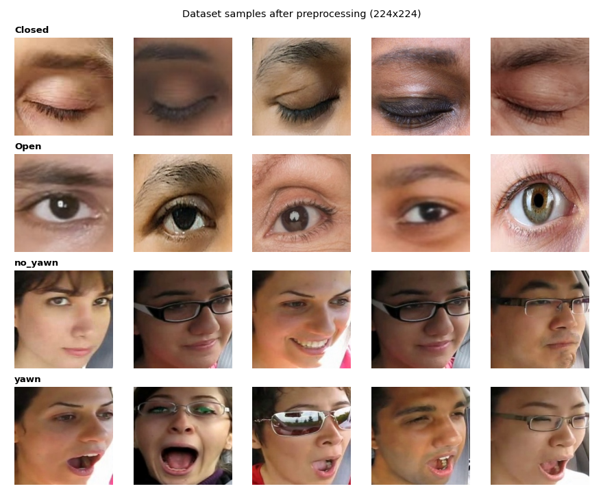

# Driver Drowsiness Detection

Detection of drowsiness signs (**closed eyes** and **yawning**) from images, using transfer learning
(MobileNetV2, ResNet50, VGG16, DenseNet121), OpenCV face detection and a Gradio demo.

> **Résumé (FR)** : projet de deep learning qui détecte les signes de somnolence d'un conducteur
> (yeux fermés, bâillements). Quatre architectures pré-entraînées (MobileNetV2, ResNet50, VGG16,
> DenseNet121) sont ajustées par *transfer learning* et comparées sur un jeu de test indépendant.


## Approach

1. **Data preparation** (`scripts/prepare_data.py`): remove duplicate images, stratified 80/10/10 split with a fixed seed, face crop for yawn images, resize to 224x224.
2. **Models** (`src/models.py`): four ImageNet backbones with a small classification head (4 classes: `Closed`, `Open`, `no_yawn`, `yawn`), each with its own `preprocess_input`.
3. **Training** (`src/train.py`): Adam (lr 1e-4), data augmentation (flip, rotation, zoom), early stopping and learning-rate reduction on plateau.
4. **Evaluation** (`src/evaluate.py`): classification report and confusion matrix on the held-out test set.
5. **Inference** (`src/predict.py`, `app/gradio_app.py`): Haar-cascade face detection, then classification of the face crop.

## Dataset

Images of eyes (`Closed`, `Open`) and faces (`yawn`, `no_yawn`), about 725 images per class.

- Source: **[add the dataset name and link here]**
- The dataset is **not stored in this repository**. Download it and run:

```bash
python scripts/organize_raw.py --src "/path/to/drowsiness-dataset/train"   # -> data/raw/{eyes,yawn}/...
python scripts/prepare_data.py                                              # -> data/processed/{train,val,test}/...
```



## Results

Results of the **original Colab experiments** (single random split of 192 test images, notebook
in `notebooks/`). Overall accuracy only; per-class results are produced by `src/evaluate.py`.

| Model | Backbone training | Test accuracy (original run) |
|---|---|---|
| VGG16 | fine-tuned | 97.9 % |
| MobileNetV2 | fine-tuned | 97.4 % |
| DenseNet121 | frozen + dense head | 93.8 % (validated on the test set, so slightly optimistic) |
| ResNet50 | frozen + dense head | 54.7 % (inputs scaled with /255 instead of ResNet preprocessing) |

**Results of the refactored pipeline** (deduplicated data, separate validation set, correct
preprocessing). *Fill in after running `python -m src.train --model all && python -m src.evaluate --model all`;
the table is written to `reports/results.csv`.*

| Model | Accuracy | Macro F1 |
|---|---|---|
| VGG16 | TBD | TBD |
| MobileNetV2 | TBD | TBD |
| DenseNet121 | TBD | TBD |
| ResNet50 | TBD | TBD |

Confusion matrices and training curves are saved in `reports/figures/`.

## Quick start

```bash
git clone https://github.com/aayoubsayeb-jpg/driver-drowsiness-detection.git
cd driver-drowsiness-detection
python -m venv .venv && source .venv/bin/activate      # Windows: .venv\Scripts\activate
pip install -r requirements.txt

# data (see "Dataset")
python scripts/organize_raw.py --src "/path/to/drowsiness-dataset/train"
python scripts/prepare_data.py

# train and evaluate (one model, or "all")
python -m src.train --model mobilenet_v2
python -m src.evaluate --model mobilenet_v2

# demo
python app/gradio_app.py            # MODEL_NAME=vgg16 python app/gradio_app.py to change model
```

Training is much faster on a GPU (for example Google Colab: clone the repo, `pip install -r requirements.txt`, mount Drive for the dataset).

### Trained models

Weights are not stored in Git (VGG16 is about 176 MB). Download them from **[add Release / Drive / Hugging Face link here]** and put them in `models/` (`mobilenet_v2.keras`, `vgg16.keras`, ...), or train them yourself.

## Project structure

```
configs/config.yaml        # seed, image size, class order, split, hyper-parameters
src/
  config.py                # loads the config (CLASSES order lives here)
  models.py                # 4 transfer-learning backbones
  data.py                  # tf.data pipelines + augmentation
  train.py  evaluate.py    # command-line training / evaluation
  predict.py               # face detection + inference
scripts/
  organize_raw.py          # original dataset layout -> data/raw/
  prepare_data.py          # dedupe, crop, stratified split -> data/processed/
app/gradio_app.py          # web demo
notebooks/                 # original Colab experiments
reports/figures/           # curves and confusion matrices
assets/                    # images used by the README
```

## Limitations and future work

- **Two tasks in one classifier.** Eye crops and face images come from different image sets and are merged into one 4-class softmax. The demo classifies a face crop, so `Closed`/`Open` outputs on a full face are outside the training distribution. A more faithful design uses two heads (or two models): one on the eye region, one on the mouth region.
- **Domain shortcut.** Eye close-ups and face images look very different, so separating the groups is easy; high accuracy mostly reflects that, not driving conditions.
- **Single frames.** Real drowsiness detection needs video (blink rate, PERCLOS, yawn duration), and testing in real driving conditions (lighting, glasses, head pose).
- **Data issues found and handled.** Duplicate images (removed), swapped colour channels in the yawn images (fixed, `fix_yawn_color`), and Haar face detection that rarely fires on images that are already face crops (the full image is kept).
- **Not a safety system.** Educational project, not validated for real vehicles.

## Author

saieb ayoub - Master's student in Software Engineering, University of Skikda (Algeria).
email : aayoubsayeb@gmail.com

Released under the MIT License.


moldels link : https://drive.google.com/drive/folders/1iliHQFEwJsPrOC0WsssktyDfnR7Bxt1R?usp=sharing